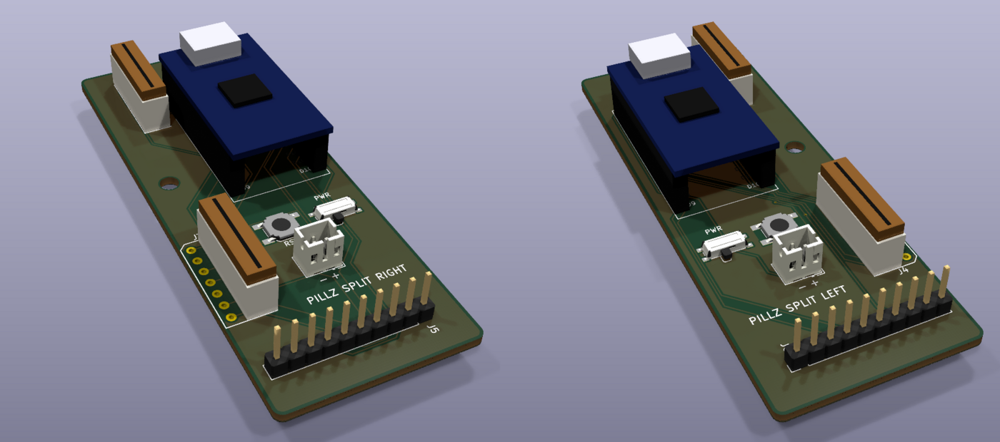
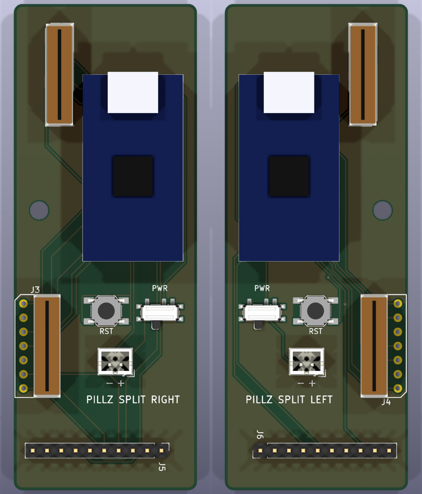

# Pillz split boards (Kinesis Advantage 2)

Two narrow boards, one per half, replacing the single pillzmod "pro" board so
the case can be cut in the middle. Each half has its own nice!nano, battery,
power switch and reset button, and talks to the other half over BLE (ZMK split).

Derived from this repo's `pcb-pro` board ([dcpedit/pillzmod](https://github.com/dcpedit/pillzmod))
(CC BY 4.0). The connector footprints and their exact positions are copied from
that board, so the key-well flex cables and the Pillz thumb ribbons reach them
unchanged.

The component side (B) faces down into the case, the bare F side faces the
keys, as with the original board (its status LEDs were the only F-side parts).
The renders look at the component side, i.e. from underneath, so the right
half is on the left of the picture and the Molex connectors sit on the outer
edges, next to the key wells.





The Molex connectors and the nice!nano (on 8.5 mm sockets) use approximate
box models from `models.py`; the rest are stock KiCad models.

## Layout

| | Left (x 100–132.5) | Right (x 167.5–200) |
|---|---|---|
| Function row | J2, Molex 39-53-2135 | J1, Molex 39-53-2135 |
| Key well | J4, 39-53-2134 right angle (dual footprint, 2135 also fits) | J3, same |
| Thumb (Pillz thumb PCB ribbon) | J6, 1x10 2.54 mm | J5, 1x10 2.54 mm |
| Controller | U1 nice!nano, top level with the middle of J2, USB towards the top edge | U1, same against J1 |
| Reset / power | SW1 SKQG / SW2 C&K PCM12SMTR (slider facing down, inner edge kept clear) | same |
| Battery | J7 JST-PH 2.0 vertical, pin 1 = + | same |
| Mounting | one M3 hole between J2 and J4 | one M3 hole between J1 and J3 |

Boards are 32.5 x 86 mm, with the same top/bottom/outer edges as the original
board. All parts go on the B side (silkscreen side, facing down in the case),
as on the upstream board. `placement.png` and `routed.png` are seen from above.
The nice!nano is mounted components up (facing away from the PCB).

**Check the battery polarity before plugging it in.** JST-PH cells don't follow
a single standard; the silkscreen marks `+` / `-`.

## Matrix to controller

No shift register: 9 rows + 7 columns = 16 GPIO per half, wired directly.
Diodes are in the switches / thumb PCB, col2row as before.

| `&pro_micro` | Left | Right |
|---|---|---|
| 1 | ROW_0 | ROW_13 |
| 0 | ROW_1 | ROW_14 |
| 2 | COL_3 | ROW_12 |
| 3 | COL_4 | COL_5 |
| 4 | ROW_2 | COL_3 |
| 5 | ROW_3 | COL_4 |
| 6 | ROW_4 | ROW_10 |
| 7 | ROW_5 | ROW_9 |
| 8 | COL_5 | ROW_11 |
| 9 | COL_6 | COL_0 |
| 14 | COL_1 | COL_6 |
| 15 | COL_2 | ROW_8 |
| 18 | ROW_14 | ROW_7 |
| 19 | ROW_13 | ROW_6 |
| 20 | ROW_12 | COL_2 |
| 21 | COL_0 | COL_1 |
| 10, 16 | free | free |

Net names follow the original matrix (`RC(row, col)` in the old transform), so
the right half's rows are ROW_6..11 and ROW_12..14.

## Building / fab files

`routed.png`: left B.Cu, left F.Cu, right B.Cu, right F.Cu. GND is poured on
both layers. JLCPCB uploads are `production/pillz_split_left.zip` and
`production/pillz_split_right.zip` (2 layers, 1.6 mm, default options).

```sh
FREEROUTING_JAR=/path/to/freerouting-1.9.0.jar ./build.sh
```

`build.sh` regenerates both boards (`gen.py`), autoroutes them with
Freerouting, pours GND (`route.py`), fails on any DRC error or unrouted
connection, then exports Gerbers + drill files and zips them. Freerouting
1.9.0 opens its window while routing, so run it from a desktop session.

`gen.py` puts a 0.6 mm track/via keepout inside the outline because
Freerouting doesn't receive KiCad's copper-to-edge rule.

Freerouting isn't deterministic and occasionally leaves one net unrouted, so
`build.sh` re-routes a half (up to `TRIES=5`) until DRC is clean. The right
half has one locked pre-route (ROW_13, J1 pin 1 to pin 11 along the outer side
of J1) that the router could never find on its own.

## Regenerating placement only

KiCad 10 Python (the flatpak works):

```sh
F="flatpak run --filesystem=$PWD --command=python3 org.kicad.KiCad"
$F extract_upstream.py  # only to refresh lib/ from ../pcb-pro
$F gen.py
python3 models.py       # only when changing the approximate 3D models
```

`gen.py` stops with an error if a connector pad doesn't land exactly where it
was on the upstream board.

Parts and replacement cables with EU vendor links: [parts-links.md](parts-links.md).
